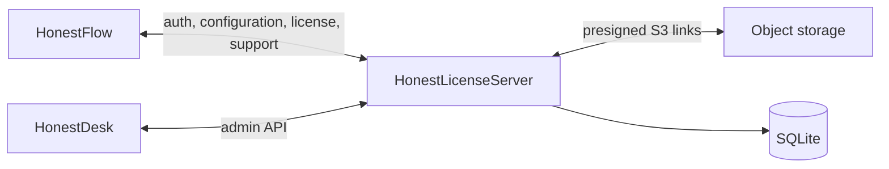

# HonestLicenseServer

HonestLicenseServer — ASP.NET Core API экосистемы HonestFlow. Сервер является источником истины для клиентов, устройств, регистраций, конфигурации, версий компонентов, опубликованных лицензий, обращений поддержки и метаданных диагностических архивов.

Полная русскоязычная спецификация API: [docs/API-RU.md](docs/API-RU.md). Согласованные архитектурные границы: [docs/architecture-decisions.md](docs/architecture-decisions.md). Канонический OpenAPI: [openapi/honest-license-v1.json](openapi/honest-license-v1.json).

## Основные сценарии

- аутентификация HonestFlow: `login`, ротация `refresh`, `logout`; access token действует 15 минут, refresh token — 30 дней; в базе хранятся только хеши;
- регистрация устройства: неизвестный или удалённый экземпляр получает ограниченную сессию и сам отправляет заявку с физическим адресом; администратор одобряет или отклоняет её;
- Service-конфигурация и лицензирование: активное устройство получает конфигурацию и точные байты последнего действующего подписанного grant; сервер проверяет подпись до сохранения;
- административный API HonestDesk: клиенты, устройства, регистрации, лицензии, версии, assets, политики, интеграционные настройки, обращения и доступ к диагностическим архивам;
- поддержка и RuDesktop: запрос помощи, защищённый сервером зашифрованный credential и отзыв удалённого доступа;
- диагностические архивы: выдача короткоживущих ссылок на прямую загрузку/скачивание из S3-совместимого объектного хранилища, фиксация SHA-256 и автоматическая очистка объектов через 48 часов;
- публичная метаинформация о версии HonestFlow и сайтовые заявки на подключение.

Сервер **не** хранит тело диагностического ZIP: в SQLite остаются только метаданные и история. Объектное хранилище настраивается внешними переменными окружения; секреты не входят в репозиторий.

## Архитектура



| Путь | Ответственность |
|---|---|
| `Controllers/` | HTTP API |
| `Contracts/` | Публичные запросы и ответы |
| `Authentication/` | Авторизация и claims |
| `Data/` | EF Core, схема SQLite, хеширование и сессии |
| `Models/DatabaseModels.cs` | Persisted-сущности |
| `Infrastructure/` | Ошибки API, проверка подписей, assets, уведомления и object storage |
| `tests/HonestLicenseServer.IntegrationTests/` | Интеграционные тесты с временной SQLite-базой |
| `deploy/`, `deploy-production.ps1` | Документированные сценарии Linux-развёртывания |

## Локальная разработка

Нужен .NET 10 SDK.

```powershell
dotnet restore HonestLicenseServer.slnx
dotnet test HonestLicenseServer.slnx -c Release
dotnet run --project HonestLicenseServer.csproj --urls http://localhost:5074
```

Локальный admin key задаётся в `appsettings.Local.json`, который исключён из Git. В production используйте внешние переменные окружения; не добавляйте секреты, ключи облака, токены или production SQLite-файл в репозиторий.

## Production

Production SQLite-база — внешнее состояние и не является артефактом публикации. Схема обновляется только аддитивным контролируемым сценарием. Кодовое развёртывание выполняется через `deploy-production.ps1 -Mode Code`; режим `-Mode Database` применяется лишь для ожидаемого изменения схемы с явным `-ExpectedColumn` и резервной копией.

Не выполняйте publish, SSH, systemd-операции, деплой или операции с production БД без отдельного разрешения.
